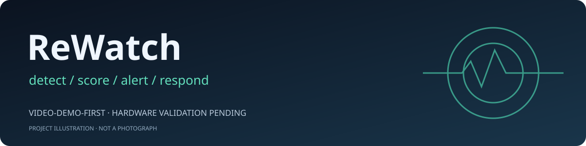
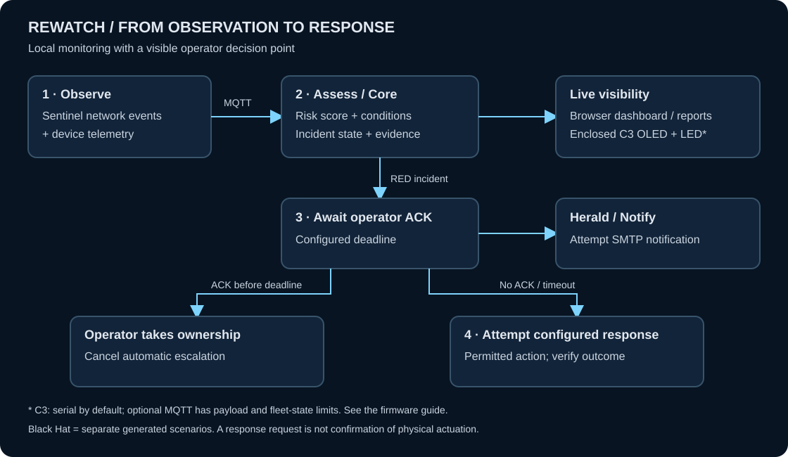

<p align="center"></p>

<h1 align="center">ReWatch(Iot)</h1>
<p align="center"><b>Open-source IoT monitoring. Local decisions. An operator in the loop.</b></p>
<p align="center"><a href="install.md">Installation</a> · <a href="hardware.md">Hardware</a> · <a href="https://youtube.com">▶ Video Demo</a> · <a href="SECURITY.md">Security</a></p>

## Abstract

**Problem:** Building IoT networks are nearly invisible to operators. Abnormal device
conditions and odd network activity surface late, cloud dashboards keep the evidence and
the ownership elsewhere, and there is no local record of what was noticed, by whom, or
when.

**Solution:** ReWatch(Iot) is a reproducible Apache-2.0 stack for an authorized network.
**Sentinel** observes traffic and telemetry, **Core** scores conditions and opens
incidents locally, and **Herald** notifies. One risk picture appears in the browser and
on the enclosed OLED/LED indicator; the operator acknowledges before any configured
response, and JSONL/SQLite evidence stays on hardware they control. A separate **Black
Hat workspace** rehearses the same workflow with generated data.

## Architecture


- **Three Pis on an authorized LAN:** Sentinel captures the mirrored/TAP feed and writes
  USB evidence; Core hosts the broker, scoring, dashboard and control requests; Herald
  turns incidents into SMTP notifications.
- **Enclosure:** the ESP32-C3 renders engine state over Core serial (default) or optional
  MQTT; the WROOM board models four AC rooms over plain Wi-Fi MQTT — no mains wiring.
- **Laptop = browser only:** dashboards, acknowledgement and capability-checked requests;
  USB is used temporarily for flashing.

## Workflow



1. **Observe:** collect authorized network events and device telemetry.
2. **Assess:** Core calculates risk and opens an incident when needed.
3. **Alert:** show the incident and request an e-mail notification.
4. **Respond:** ACK cancels automatic escalation; otherwise attempt the configured response and verify the outcome.

## Key Features

- **Local dashboard:** risk history, alerts, device groups, controls and reports.
- **Rule-based detection:** network patterns, device anomalies and telemetry consistency checks.
- **Operator-led response:** acknowledgement deadlines and explicitly permitted device actions.
- **Recorded evidence:** JSONL logs, SQLite history and report export.
- **Black Hat exercises:** 28 generated office assets, replay and incident scenarios—separate from live data.

## Video Demo

### [▶ Watch on YouTube](https://youtube.com)

*YouTube placeholder; the recording URL will be added later.*
The existing recording is also available [in this repository](demo/VIDEO.md).

## Prerequisites

| Setup | What you need |
| --- | --- |
| Black Hat workspace | Git, Bash, Python 3.10+ with `venv`, and a modern browser. No Pis or MQTT broker required. |
| Three-Pi deployment | Raspberry Pi 4 + two Pi 3s, Raspberry Pi OS, microSD cards, suitable power supplies, Ethernet and SSH access. |
| Network and evidence | Authorized LAN, switch SPAN/mirror port or TAP for capture, USB storage, compatible Wi-Fi adapters; SMTP account for e-mail delivery. |
| Enclosure hardware | ESP32-C3, SSD1306 OLED and addressable pixel; optional ESP32-WROOM for the Black Hat AC model. PlatformIO and USB cables for flashing. |

See the [hardware guide](hardware.md) for exact wiring and adapter requirements.
WROOM uses Wi-Fi MQTT; C3 MQTT is optional, with serial as the default. Read the
[firmware transport limits](firmware/README.md) before choosing the connection.
Remote passkeys require trusted HTTPS and a matching hostname.

## Getting Started

### Black Hat workspace

```bash
git clone https://github.com/ADITYA02NM/ReWatch-IOT-.git
cd ReWatch-IOT-
./demo/run.sh
```

Open **http://localhost:8080** → **Access code** → `rewatch`.
This is a shared local exercise code, not a live-deployment password.
See the [Black Hat guide](demo/README.md) for scenarios and settings.

### Physical installation

Follow **[install.md](install.md)** for Pi OS, SSH, firmware, networking, passkeys
and startup. It also covers a **Linux laptop running the real-data dashboard and
collectors**, separately from Black Hat exercises.

## Documentation

| Guide | Contents |
| --- | --- |
| [Installation](install.md) | End-to-end Pi and laptop setup |
| [Hardware](hardware.md) · [Firmware](firmware/README.md) | Components, wiring, flashing and transport limits |
| [Operator manual](pi4-core/web/manual.html) | Dashboard, incident workflow and interfaces |
| [Security](SECURITY.md) | Trust boundaries and deployment precautions |
| [Third-party notices](THIRD_PARTY.md) | Dependencies and attribution |

## Responsible Use & License

Use only on systems you are authorized to monitor. The default MQTT broker is
anonymous and unencrypted: isolate the network and do not expose it publicly.
Responses are requests, not proof of physical actuation; SMTP acceptance is not
proof of delivery. ReWatch(Iot) is not a certified safety controller.

**[Apache-2.0](LICENSE)** · [Notice](NOTICE). Contributions and reproducible bug reports are welcome.
