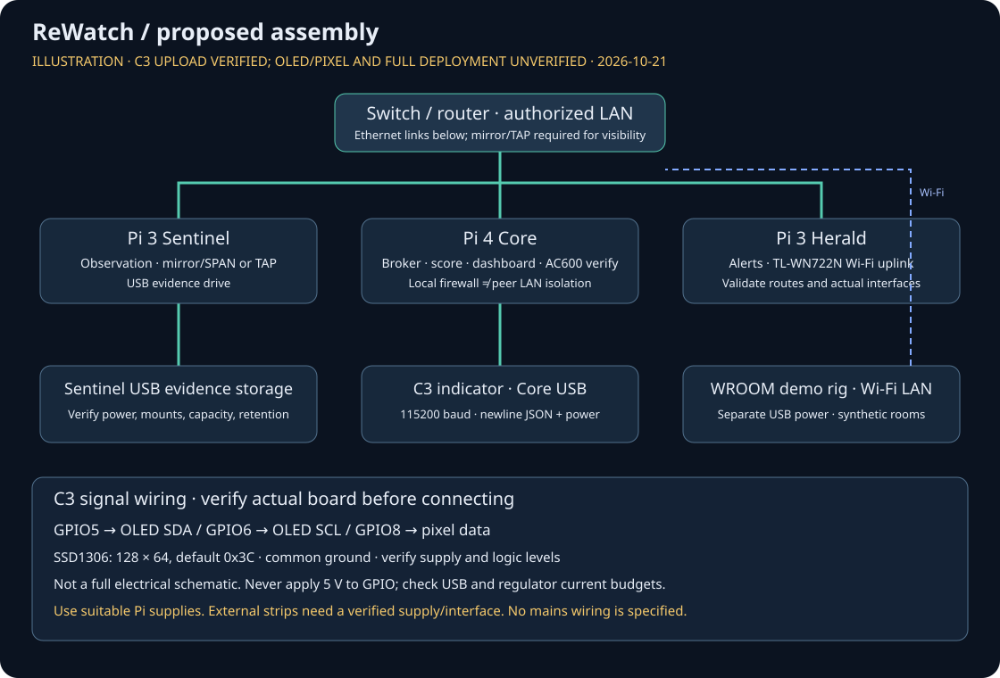
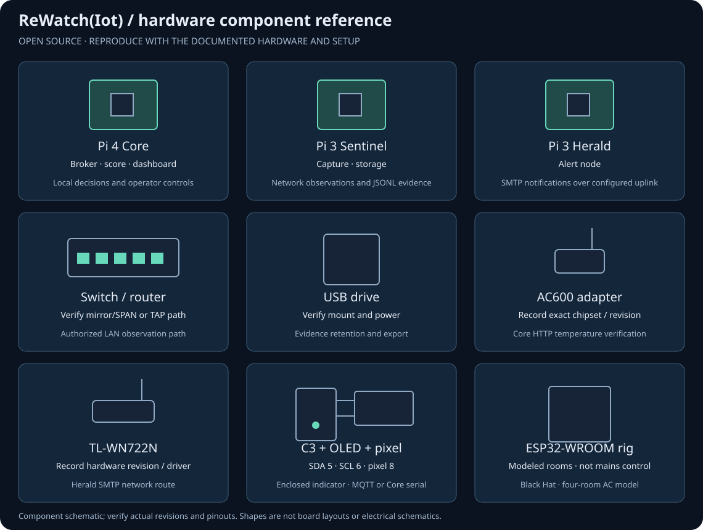
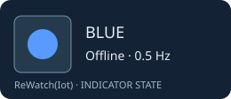
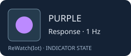

# Hardware reference

**Last updated: 2026-10-21 · Status: intended assembly; C3 upload verified, full hardware deployment unvalidated.**

ReWatch is presented video-demo-first. Software/demo output is not evidence of a
working physical installation. All images below are **illustrations, not photographs**;
the topology describes intended roles, not a measured or tested deployment.

## Intended topology and wiring

| Device | Intended role / connection | Validation still needed |
| --- | --- | --- |
| Raspberry Pi 4 Core | Ethernet to LAN; broker, scoring/dashboard and response; USB to C3 | Power budget, USB enumeration, serial delivery, sustained load |
| Raspberry Pi 3 Sentinel | Ethernet observation node; USB drive for storage | Capture visibility, drive mount and retention, power stability |
| Raspberry Pi 3 Herald | Ethernet alert node; TL-WN722N Wi-Fi SMTP uplink | Actual interface mapping, routes, mail delivery |
| Switch / router | Connect nodes and the authorized test LAN | Mirror/SPAN support or a suitable TAP; routing policy |
| USB drive | Proposed Sentinel storage, not a backup guarantee | Format, permissions, mount persistence and capacity |
| AC600 USB adapter | Core Wi-Fi HTTP verification link | Exact chipset/revision, Linux driver and association |
| TL-WN722N USB adapter | Herald Wi-Fi SMTP connection | Exact hardware revision, driver and association |
| ESP32-C3 + OLED + pixel | Core USB serial indicator | Board pinout, OLED address, pixel type and supply |
| ESP32-WROOM rig | USB-powered, Wi-Fi-connected synthetic room controller | Firmware upload, connectivity and safe demo-only operation |

Adapter placement above is an assembly proposal, not an assertion that installed
interfaces match it. Map real adapters to interface names before deployment.

### Firmware-grounded indicator pins

The checked-in [C3 configuration](firmware/esp32-c3-indicator/include/config.h)
and [firmware guide](firmware/README.md) specify:

| Signal | Connection |
| --- | --- |
| Serial + power | Pi 4 USB → C3 USB; 115200 baud, newline-delimited JSON |
| OLED SDA | C3 GPIO5 → SSD1306 SDA |
| OLED SCL | C3 GPIO6 → SSD1306 SCL |
| OLED geometry / default address | 128 × 64; `0x3C` |
| Pixel data | GPIO8; firmware assumes one addressable pixel; verify the actual board |
| Link loss | After 3000 ms without updates: blue / sleeping display |

Use common ground for attached modules. Verify the actual board schematic before
wiring: not every C3 SuperMini has an addressable pixel on GPIO8. Confirm the
OLED's supply and logic compatibility; the table is **not** a complete electrical
schematic. Do not connect 5 V to GPIO. External pixels/strips need a separately
verified supply, current budget and appropriate data-level interface; do not assume
the Pi USB port or C3 regulator can power a strip. Use suitable independent Pi
supplies; validate USB-drive and adapter load, cables and brownout behavior.

The [WROOM firmware](firmware/esp32-wroom-rig/src/main.cpp) uses GPIO2 for its
onboard LED and GPIO0 (BOOT, input pull-up) to toggle the Room-1 spike. It simulates
room devices; it is **not** an AC mains controller. No relay or mains wiring is
specified here. Keep the rig off and aside when using real building IoT devices.

## Observation and deployment limits

- **Switched Ethernet:** connecting Sentinel to an ordinary switch port does not
  expose other hosts' unicast traffic. Use a configured mirror/SPAN port or a
  suitable network TAP for that traffic. Check both traffic directions and mirror
  capacity; the diagram does not imply full visibility.
- **Wi-Fi hardware:** “AC600” is a speed class, not a chipset guarantee. TL-WN722N
  revisions differ internally. Record model, hardware revision, USB ID, chipset,
  driver and firmware before claiming monitor-mode or other capture support.
  An associated Wi-Fi interface is not automatically a monitor interface, and
  encrypted traffic is not automatically decryptable. Only observe authorized networks.
- **Interface names and routing:** USB enumeration can change names. Verify actual
  capture/uplink interfaces and routes rather than assuming `wlan1` identifies a
  particular adapter. A second Wi-Fi link is not inherently an isolated management network.
- **Firewall scope:** rules applied on the Core protect/control traffic traversing
  that host. They do **not** isolate arbitrary peer LAN hosts unless Core is an
  explicitly configured inline gateway/bridge or network enforcement is provided
  elsewhere. Do not demonstrate a local block as whole-LAN quarantine.
- **Passkeys and TLS:** browser WebAuthn needs a secure context. `localhost` is a
  development exception; plain HTTP on a remote Pi LAN IP is not equivalent.
  For remote passkey access use HTTPS with a trusted certificate and matching
  hostname/origin, and configure the application accordingly. A `.local` name
  alone does not provide TLS or trust.

## Device-photo slots

These filenames are **future evidence slots**, not links to missing images. Add
real, sanitized photographs under `assets/hardware/` and replace the relevant
placeholder only after assembly. Include board revision, date and what was tested
in the caption; adding a photo alone does not validate operation.

| Subject | Future filename |
| --- | --- |
| Pi 4 Core | `pi4-core-photo.jpg` |
| Pi 3 Sentinel | `pi3-sentinel-photo.jpg` |
| Pi 3 Herald | `pi3-herald-photo.jpg` |
| Switch / router | `switch-router-photo.jpg` |
| USB drive | `usb-drive-photo.jpg` |
| AC600 adapter, revision label | `ac600-photo.jpg` |
| WN722N adapter, revision label | `wn722n-photo.jpg` |
| C3 + OLED + pixel, visible wiring | `c3-oled-pixel-photo.jpg` |
| WROOM rig | `wroom-rig-photo.jpg` |

Remove SSIDs, credentials, personal labels and identifying network details before
publishing. Do not commit secrets or private keys.

## Indicator state illustrations

Static miniatures show the intended color, **not captured device output**. Timing
labels describe firmware behavior; the SVGs themselves do not animate. Purple
indicates a response state, not proof that network isolation succeeded.

| Illustration | Meaning / firmware cadence |
| --- | --- |
|  | Normal; steady green |
|  | Offline / no link; 0.5 Hz blue on/off blink, not a brightness throb |
|  | Scan or drift; 2 Hz yellow on/off blink |
|  | Critical; 4 Hz red blink |
|  | Unacknowledged → automated response; 1 Hz purple on/off blink |

## Hardware evidence to collect later

Record the actual bill of materials/revisions and power supplies, wiring photos,
firmware build identifiers, interface/driver inventory, capture-path tests,
indicator/link-loss behavior, storage persistence, alert delivery, trusted HTTPS
passkey access, and the precise scope of any response. Until those checks are
performed and recorded, this page remains an **unvalidated assembly reference**.

### Partial bench evidence — 21 October 2026

The connected ESP32-C3 was identified over a CP2102 UART bridge, and the
`esp32-c3-uart` environment uploaded successfully with flash hash verification.
The local demo serial bridge was started at 115200 baud. This establishes an
upload/host link, **not** visual verification of the OLED/pixel or a tested
three-Pi deployment. Verify display output on the physical board separately.

## Device integration boundaries

Radio placement is **Core: AC600**, **Herald: TL-WN722N**; Sentinel's USB
attachment here is its evidence storage, not an implied extra Wi-Fi adapter.
Validate interface names and routes on the actual machines.

The WROOM board demonstrates AC behavior only. Cameras, doors, plugs, lights,
fans and sensors require explicitly supported, opted-in MQTT bridge capability
profiles and independent device-specific checks. A device label or capability
advertisement is not demonstrated compatibility, native ONVIF/Matter support,
or authority to actuate it. No automatic door unlock or firmware write is part
of the documented response; do not infer physical action from a dashboard label.
